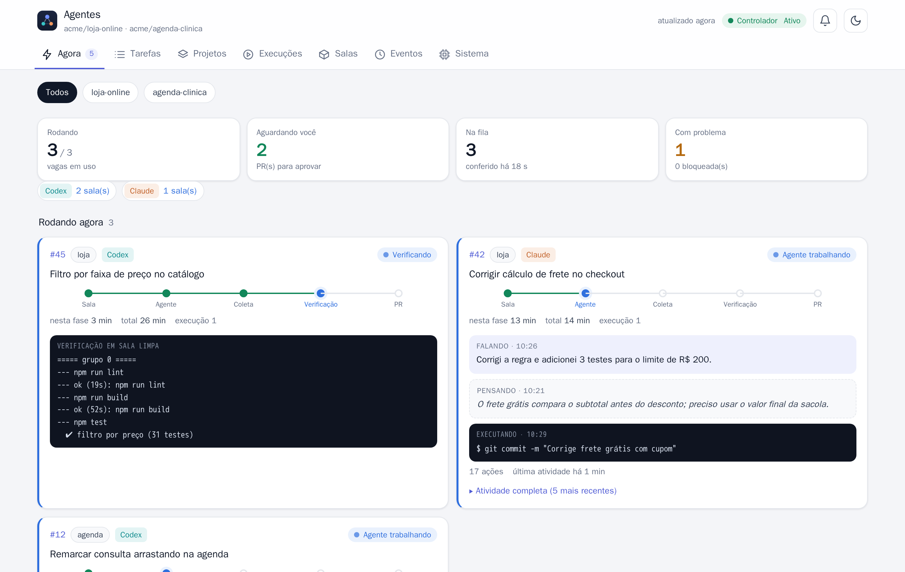
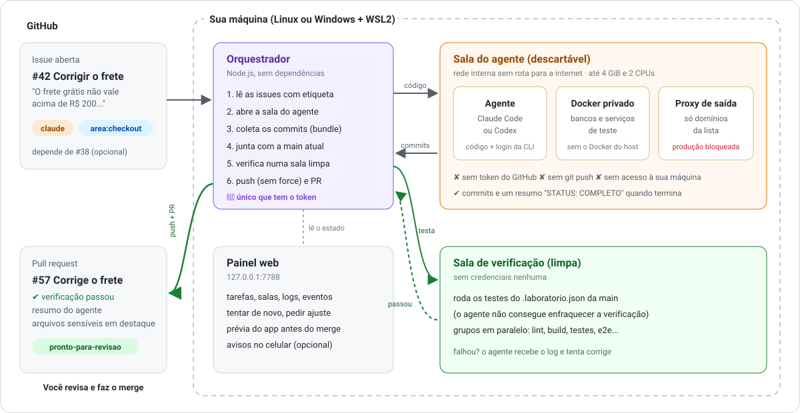

<h1 align="center">Agents Lab (Laboratório de Agentes)</h1>

<p align="center">
  <b>Write an issue. Get a tested pull request.</b><br>
  Claude Code and Codex working as developers on your GitHub repo, on your own machine, inside isolated Docker rooms.
</p>

<p align="center">
  <a href="https://github.com/__REPO__/actions/workflows/testes.yml"></a>
  <a href="LICENSE"></a>
  
  
  
  
</p>

<p align="center"><a href="README.md">🇧🇷 Português</a> (main docs, UI and messages are in Brazilian Portuguese)</p>

<p align="center">
  <picture>
    <source media="(prefers-color-scheme: dark)" srcset="docs/imagens/painel-escuro.png">
    
  </picture>
</p>

> **You sleep, the agents work.** Put the `claude` or `codex` label on an issue and the lab does the
> rest: it opens a disposable room, lets the agent code, re-runs your tests in a clean room and only
> then opens the PR. Merging is always up to you.

## How it works

<p align="center">
  
</p>

1. You open an issue and label it `claude` or `codex` (both = whichever agent is less busy).
2. The orchestrator opens an isolated **room** and the agent works on a copy of the code, with **no GitHub token**.
3. Commits leave the room as a `git bundle` and are **tested again in a clean room**, using the commands
   defined on your `main` branch, so the agent can't weaken its own checks.
4. If everything passes, the orchestrator pushes (never `--force`) and opens the PR. You review and merge.

## Why it's different

| | Agent in your terminal | Agents Lab |
|---|---|---|
| Tasks at once | one, while you watch | up to 3, unattended, from the issue queue |
| Where the agent runs | your machine, your files, your tokens | a disposable Docker room, no GitHub token |
| Who says it works | the agent says it tested | a clean room re-runs **your** tests |
| Internet access | unrestricted | allowlisted domains only; production blocked |
| When the quota runs out | you wait and come back | pauses and resumes at reset time |
| Output | changes in your folder | a PR with summary, test results and review hints |

## Features

- **Issue-driven queue** with `area:<name>` labels to avoid two tasks touching the same code, and
  `depends on`-style chaining (`depende de #N`), including stacked stages.
- **Isolated rooms**: internal network with no direct route out, a per-room Squid egress proxy with an
  allowlist, a private Docker-in-Docker for databases and services, CPU/memory/PID limits. The host
  Docker socket is never mounted.
- **Independent verification** in a credential-free room; on failure the agent gets the sanitized log and tries again.
- **Resilience**: exponential retries, per-agent quota pause (multiple accounts supported), circuit
  breaker for environment failures, persistent outbox, recovery after reboot.
- **Web dashboard**: tasks, rooms (CPU/memory), sanitized logs, events, retry button, "request a
  change" on a PR, live preview of the app before merging, optional phone notifications (Web Push).
- **Multi-project**: add repositories from the dashboard; each gets its own state, images and rooms.
- **Works with subscriptions** (Claude Pro/Max, ChatGPT Plus/Pro via CLI login) **or API keys**.
- **Zero npm dependencies**: plain Node.js, Bash and Docker.

## Quick start

Requirements: Linux or Windows 10/11 with WSL2, Docker, Node.js 22+, and a Claude and/or Codex login.

```bash
git clone https://github.com/__REPO__.git ~/laboratorio-agentes
cd ~/laboratorio-agentes
./scripts/instalar.sh                      # checks everything, creates local files, runs the tests
nano secrets/github-controller.env         # paste a fine-grained GitHub token into GH_TOKEN=
./scripts/install-user-service.sh --ativar # starts the dashboard and the orchestrator (systemd)
```

Open **http://127.0.0.1:7788**, go to **Projetos** (Projects) and add your repository. Then click
**Gerar configuração** (Generate configuration): an agent writes the `.laboratorio.json` for your project
(how to install, test and preview it). Merge that PR and start labeling issues.

Time to first PR: ~30 min if you already have Docker and Node; 1–2 h on a fresh Windows machine.
Step-by-step guide (Portuguese): [docs/INSTALACAO.md](docs/INSTALACAO.md). Machine translation works well on it.

**Using an AI agent to install it?** Point it to [AGENTS.md](AGENTS.md): it contains a full install
and adaptation playbook with safety rules.

## Security model, briefly

Agents and issue text are treated as untrusted. Rooms have no GitHub credentials, no host Docker and
only allowlisted egress; production domains are denied before any allow rule; logs are scrubbed of
tokens; changes to `.github/workflows` block delivery; humans always merge. Known limits (CLI login is
copied into the room, DinD runs privileged, the dashboard has no auth and binds to 127.0.0.1) are
documented in [SECURITY.md](SECURITY.md).

## Built with AI

This project was built in partnership with AI. Ideas, decisions and reviews are human; much of the
code, tests and docs were written with **Claude Code** and **Codex**, the same agents the lab puts to
work. AI helping build the house it will work in, with the doors locked.

## Contributing

Issues and PRs welcome, in English or Portuguese. See [CONTRIBUTING.md](CONTRIBUTING.md).
If this helps you, a ⭐ helps others find it.

## License

[MIT](LICENSE).
