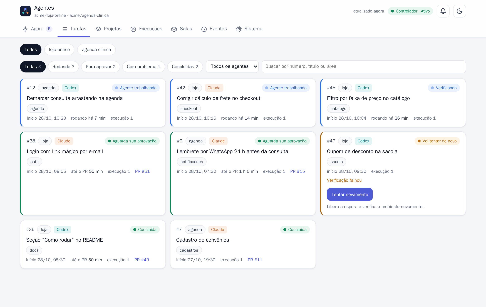
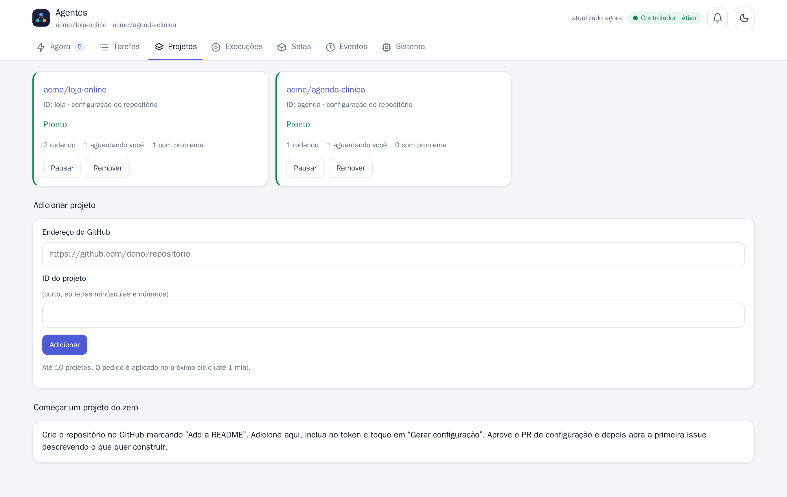
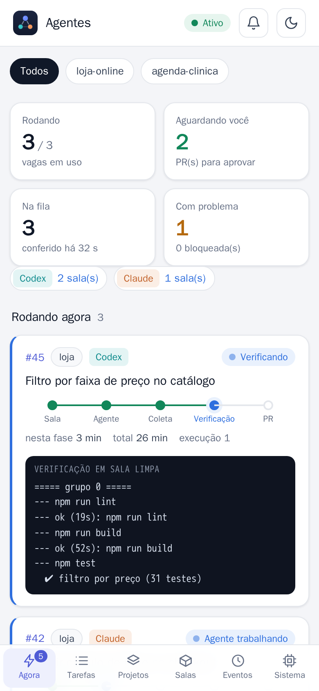

<h1 align="center">Laboratório de Agentes</h1>

<p align="center">
  <b>Escreva uma issue. Receba um pull request testado.</b><br>
  Claude Code e Codex trabalhando como desenvolvedores do seu repositório, na sua máquina, em salas Docker isoladas.
</p>

<p align="center">
  <a href="https://github.com/RafaelGoulartP/agents-publico/actions/workflows/testes.yml"></a>
  <a href="LICENSE"></a>
  
  
  
  
</p>

<p align="center">
  <a href="docs/INSTALACAO.md">Instalação</a> ·
  <a href="docs/PREPARAR-PROJETO.md">Preparar seu projeto</a> ·
  <a href="docs/CONFIGURACAO.md">Configuração</a> ·
  <a href="AGENTS.md">Para agentes de IA</a> ·
  <a href="README.en.md">🇺🇸 English</a>
</p>

> **Você dorme, os agentes trabalham.** Coloque a etiqueta `claude` ou `codex` numa issue e o
> laboratório faz o resto: abre uma sala descartável, deixa o agente programar, testa o resultado de
> novo numa sala limpa e só então abre o PR. O merge é sempre seu.

<p align="center">
  <picture>
    <source media="(prefers-color-scheme: dark)" srcset="docs/imagens/painel-escuro.png">
    
  </picture>
</p>

## Como funciona

<p align="center">
  
</p>

1. Você abre uma issue e coloca a etiqueta `claude` ou `codex`.
2. O orquestrador abre uma **sala** isolada e o agente trabalha numa cópia do código, sem o token do GitHub.
3. Os commits saem da sala e são **testados de novo numa sala limpa**, com os testes definidos na sua `main`.
4. Passou: o orquestrador faz o push e abre o PR. Você revisa e faz o merge.

## Por que é diferente

| | Agente no seu terminal | Laboratório de Agentes |
|---|---|---|
| Quantas tarefas ao mesmo tempo | uma, com você olhando | até 3, sozinhas, a partir da fila de issues |
| Onde o agente roda | na sua máquina, com seus arquivos e tokens | numa sala Docker descartável, sem token do GitHub |
| Quem garante que funciona | o próprio agente diz que testou | uma sala limpa roda os **seus** testes de novo |
| Acesso à internet | livre | só domínios de uma lista; produção bloqueada |
| Quando a cota acaba | você espera e lembra de voltar | pausa e retoma sozinho no horário de renovação |
| Resultado | mudanças na sua pasta | um PR com resumo, testes e pontos de atenção |

## O que ele faz

- **Fila a partir das issues.** Toda issue aberta com a etiqueta `claude` ou `codex` vira uma tarefa.
  Com as duas etiquetas, vai para o agente menos ocupado.
- **Salas isoladas.** Cada tarefa ganha uma rede interna sem rota para a internet, um proxy de saída
  (Squid) que só libera domínios de uma lista, um Docker próprio (Docker-in-Docker) para bancos e
  serviços de teste, e limites de CPU, memória e processos. O socket Docker da sua máquina nunca entra na sala.
- **O agente nunca vê o token do GitHub.** O código entra e sai da sala como `git bundle`. Só o
  controlador, fora das salas, faz `push` (nunca `--force`) e abre o PR.
- **Verificação independente.** O resultado do agente é testado de novo numa sala limpa, sem
  credenciais, com os comandos definidos na branch principal do projeto (o agente não consegue
  enfraquecer os testes). Se falhar, o agente recebe o log e tenta corrigir.
- **Resiliência.** Novas tentativas com espera crescente, pausa automática quando a cota do agente acaba
  (inclusive com várias contas), disjuntor para falhas de ambiente, fila persistente de comentários e
  etiquetas, recuperação depois de reiniciar o PC.
- **Organização do trabalho.** Etiquetas `area:<nome>` evitam duas tarefas mexendo na mesma parte do
  código ao mesmo tempo. `depende de #N` na issue espera a outra terminar, ou constrói em cima dela.
- **Painel web** com tarefas, salas (CPU/memória), logs sanitizados, eventos, botão "tentar
  novamente", pedido de ajuste num PR, prévia do app para testar antes do merge e avisos no celular
  (Web Push, opcional).
- **Vários projetos.** Adicione repositórios pela aba **Projetos** do painel. Cada um tem estado,
  imagens e salas separados, e as vagas são divididas entre eles.

## Painel

| Tarefas de todos os projetos | Projetos | No celular |
|---|---|---|
|  |  |  |

As imagens usam dados de demonstração (`node scripts/demo-painel.mjs`); para gerá-las de novo, veja
`scripts/capturas.mjs`.

## Requisitos

| | Mínimo | Observação |
|---|---|---|
| Sistema | Linux (Ubuntu 22.04+, Debian 12+) ou **Windows 10/11 com WSL2** | macOS: experimental |
| Docker | Docker Engine 24+ ou Docker Desktop | no Windows, Docker Desktop com integração WSL |
| Node.js | 22 ou mais novo | dentro do Linux/WSL |
| Memória | 8 GB livres para 1 sala; 16 GB para 3 salas | cada sala usa até 4 GiB e 2 CPUs |
| Disco | 30 GB livres | imagens das salas e cópias dos testes |
| Agentes | Assinatura do **Claude** (Pro/Max) e/ou do **ChatGPT** (Plus/Pro), ou chaves de API | basta um dos dois |
| GitHub | Um token *fine-grained* com acesso aos repositórios | veja o passo a passo |

## Começo rápido

O passo a passo completo, do zero, está em **[docs/INSTALACAO.md](docs/INSTALACAO.md)**.

**Quanto tempo leva:** uns 30 minutos se você já tem Docker e Node; de 1 a 2 horas num Windows do zero
(WSL, Docker Desktop e reinicialização). Depois, a primeira imagem de cada projeto leva mais 5 a 20 minutos.
Resumo para quem já tem Docker e Node:

```bash
git clone https://github.com/RafaelGoulartP/agents-publico.git ~/laboratorio-agentes
cd ~/laboratorio-agentes
./scripts/instalar.sh            # confere tudo, cria os arquivos locais e roda os testes
nano secrets/github-controller.env   # cole o token do GitHub em GH_TOKEN=
./scripts/install-user-service.sh --ativar   # liga painel e orquestrador (systemd)
```

Abra **http://127.0.0.1:7788**, vá na aba **Projetos** e adicione o seu repositório. O laboratório
confere o acesso e cria as etiquetas. Se o repositório ainda não tem `.laboratorio.json`, clique em
**Gerar configuração**: o laboratório abre uma issue para o Codex escrever esse arquivo. Revise e faça
o merge do PR. O laboratório constrói a imagem do projeto e passa a atender as issues.

## Preparar o seu projeto

Os agentes trabalham melhor quando o repositório explica a si mesmo. O guia
**[docs/PREPARAR-PROJETO.md](docs/PREPARAR-PROJETO.md)** mostra o que deixar pronto no GitHub: o
`.laboratorio.json`, um `AGENTS.md` que o agente lê antes de cada tarefa (com modelo para copiar),
como escrever boas issues (com template) e como revisar e pedir ajustes.

## Como usar no dia a dia

1. Crie uma issue descrevendo o que quer, com critérios de aceitação claros.
2. Coloque a etiqueta do agente: `claude`, `codex` ou as duas.
3. Coloque uma ou mais etiquetas de área, como `area:frontend` ou `area:api`. Issues da mesma área
   nunca rodam ao mesmo tempo. Sem área, a issue usa `area:geral`.
4. Para encadear tarefas, escreva `depende de #12` no corpo. A issue espera a #12 ser concluída, ou
   é construída em cima da etapa já verificada.
5. Acompanhe pelo painel. Quando o PR aparecer com a etiqueta `pronto-para-revisao`, revise e faça o merge.

| Etiqueta | Quem coloca | Significado |
|---|---|---|
| `claude` / `codex` | você | qual agente faz a tarefa |
| `area:<nome>` | você | parte do código; trava outras issues da mesma área |
| `em-andamento` | laboratório | uma sala está trabalhando nela |
| `pronto-para-revisao` | laboratório | PR aberto esperando você |
| `bloqueado` | laboratório | parou depois de várias falhas; **tire a etiqueta** para tentar de novo |

O agente só entrega quando declara `STATUS: COMPLETO` e a verificação passa. Solução parcial não vira
PR: o trabalho fica guardado e a próxima tentativa continua de onde parou.

## Configuração de cada projeto: `.laboratorio.json`

Fica na raiz do **seu** repositório e diz ao laboratório como instalar e testar o projeto. O próprio
laboratório pede ao agente que o escreva na primeira vez. Exemplo para um app Node:

```json
{
  "dependencias": ["package-lock.json"],
  "instalar": ["npm ci"],
  "verificar": [["npm run lint", "npm test", "npm run build"]],
  "leia": ["AGENTS.md", "README.md"],
  "proibido": { "dominios": ["meusite.com.br"], "portas": [], "pastas": [], "texto": "nunca use dados reais" },
  "imagensDeTeste": ["postgres:16"],
  "dominiosExtras": [],
  "previa": { "porta": 5173, "passos": [{ "rodar": "npm run dev -- --host 0.0.0.0", "esperar": "http://127.0.0.1:5173/" }], "logins": "" }
}
```

Referência de todos os campos: [docs/CONFIGURACAO.md](docs/CONFIGURACAO.md).

## Segurança, em resumo

- Os agentes rodam com permissões amplas (`--dangerously-skip-permissions`), mas **dentro da sala**:
  sem o token do GitHub, sem o Docker da máquina e com internet só pelos domínios liberados em
  [proxy/allowed-domains.txt](proxy/allowed-domains.txt).
- Domínios de produção listados em `proibido.dominios` (ou em `rooms.deniedDomains`) são **negados
  antes** de qualquer liberação no proxy.
- O login das CLIs é **copiado** para a sala, nunca montado. Logs passam por um filtro que remove
  tokens antes de ir para o painel, para comentários ou para o PR.
- O merge é sempre humano. O laboratório não altera `.github/workflows`.
- O painel não tem senha e escuta só em `127.0.0.1`. Para abrir no celular, use uma VPN como o
  Tailscale (veja [docs/INSTALACAO.md](docs/INSTALACAO.md#painel-no-celular-opcional)).

Detalhes e como relatar problemas: [SECURITY.md](SECURITY.md).

## Estrutura

```
orchestrator/        controlador e painel (Node.js puro, sem npm install)
  src/main.mjs         laço principal do orquestrador
  src/dashboard.mjs    painel web (127.0.0.1:7788)
  config.example.json  configuração padrão (copiada para config.json, fora do Git)
  test/                testes (npm test)
scripts/             instalação, salas (create/destroy/inspect), imagens, prévia, serviços
images/              Dockerfiles das salas (base do projeto + Claude Code / Codex)
proxy/               proxy de saída (Squid) e lista de domínios liberados
systemd/             modelos dos serviços do usuário
secrets/             SÓ modelos *.example; os arquivos reais ficam fora do Git
docs/                instalação, preparar o projeto, configuração e decisões
```

## Para agentes de IA

Se você é um agente (Claude Code, Codex etc.) e vai instalar ou adaptar este repositório para alguém,
leia primeiro **[AGENTS.md](AGENTS.md)**.

## Problemas comuns

| Sintoma | O que fazer |
|---|---|
| `bash\r: No such file` ou `$'\r': command not found` | O clone foi feito no Windows. Clone **dentro do WSL** (`cd ~ && git clone ...`). |
| `permission denied ... docker.sock` | Linux: `sudo usermod -aG docker $USER` e entre de novo. WSL: abra o Docker Desktop e ative a integração com a distribuição. |
| Painel não abre no Windows | Use `http://127.0.0.1:7788`, não `localhost`. |
| Projeto fica "sem acesso" | O token não inclui o repositório ou falta permissão de escrita em Contents, Issues ou Pull requests. |
| `imagem sala-... ausente` | O projeto ainda não terminou de construir as imagens. Veja a aba Projetos. |
| Tarefa "bloqueada" | Abra o painel, leia o motivo, ajuste a issue e **tire a etiqueta `bloqueado`**. |

Mais diagnósticos em [docs/INSTALACAO.md](docs/INSTALACAO.md#resolvendo-problemas).

## Testes

```bash
cd orchestrator && npm test                                   # unidade e integração local (~10 s)
LAB_DOCKER_TEST=1 node --test test/docker-integration.test.mjs  # salas reais com agente falso (~3 min)
```

## Feito com IA

Este projeto foi criado em parceria com inteligência artificial. A ideia, as decisões e as revisões
são humanas; boa parte do código, dos testes e da documentação foi escrita com o **Claude Code** e o
**Codex**, os mesmos agentes que o laboratório coloca para trabalhar. É um pouco de IA ajudando a
construir a casa onde ela mesma vai trabalhar, com as portas trancadas.

## Créditos

Nenhum código de outro repositório foi copiado para cá, mas o projeto se apoia em ferramentas de
muita gente: Claude Code, Codex, Docker, Squid, Node.js, Debian, Playwright e outras. Também se
inspirou em ideias do [gh-aw](https://github.com/github/gh-aw), do [OpenHands](https://github.com/OpenHands/OpenHands)
e do [SWE-agent](https://github.com/SWE-agent/SWE-agent). Lista completa, com licenças, em
[docs/CREDITOS.md](docs/CREDITOS.md).

## Contribua

Achou um problema, instalou num sistema diferente ou tem uma ideia? Abra uma
[issue](https://github.com/RafaelGoulartP/agents-publico/issues) ou um PR (veja [CONTRIBUTING.md](CONTRIBUTING.md)).
Se o projeto te ajudou, deixe uma ⭐: isso ajuda outras pessoas a encontrá-lo.

## Licença

[MIT](LICENSE).
